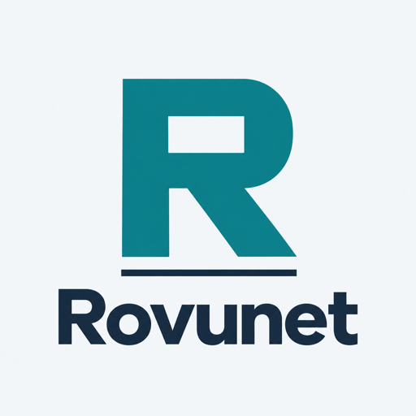

<div dir="rtl">

<p align="center"></p>

<h1 align="center">پنل رووُنت (Rovunet Panel)</h1>

<p align="center"><b>سرور خودمیزبان و چندپروتکلی برای عبور از فیلترینگ</b><br>یک نصب، همهٔ پروتکل‌های تحت مدیریت، و برای هر کاربر کانفیگ آماده و لینک اشتراک.</p>

<p align="center">
  <a href="https://github.com/msVPNco/rovunet-panel/releases/latest"></a>
  
  <a href="LICENSE"></a>
  <a href="https://t.me/RovunetVPN"></a>
</p>

<p align="center"><a href="README.md">English</a> · <b>فارسی</b> · <a href="README.ru.md">Русский</a> · <a href="README.zh-CN.md">简体中文</a></p>

<p align="center">📘 <a href="docs/guides/Rovunet-Panel-Guide-FA.pdf">راهنمای جامع (PDF)</a> · <a href="docs/fa/README.md">مستندات</a> · <a href="https://github.com/msVPNco/rovunet-app">اپ اندروید</a> · <a href="CHANGELOG.md">تغییرات</a></p>

---

**نسخهٔ ۱.۲۱.۲ — نصب، آپدیت سرور، سپس Update همان اشتراک در اپ.** حساب آزادِ واجد همهٔ شرایط، ۲۴ پروفایل اشتراک برای اندروید و ویندوز فعلی دریافت می‌کند. آپدیت، هسته‌های جاافتاده را کامل و Hy2 قدیمی را با حفظ رمز اختصاصی به Salamander منتقل می‌کند؛ آدرس اشتراک و توکن کاربران ثابت می‌ماند. اشتراک را حذف نکنید و لینک تازه نفرستید. ویندوز Beta قدیمی موارد پشتیبانی‌شده را نگه می‌دارد؛ AWG به کلاینت فعلی نیاز دارد. [راهنمای نسخه و سازگاری](docs/releases/v1.21.2.md) · [پذیرش جامعِ باقی‌مانده](docs/release-gates.json).


پنل رووُنت ابزاری متن‌باز است که یک سرور لینوکسی را به سرور دسترسی چندپروتکلی تبدیل می‌کند. هر پروتکل را به‌صورت سرویس systemd نصب و مدیریت می‌کند، کاربر می‌سازد و کانفیگ کلاینت‌ها را خروجی می‌دهد، تا هر کاربر چند مسیر اتصال مستقل داشته باشد و به یک پروتکل یا یک وضعیت شبکه وابسته نماند.

## ویژگی‌ها

- **مدیریت پروکسی، SSH، تونل DNS و هسته‌های پروتکل**، شامل AmneziaWG، Shadowsocks 2022، Trojan TLS و VLESS Encryption، با یک ابزار خط فرمان و منوی تعاملی.
- **دسترسی اختصاصی حساب روی مسیرهای دارای احراز هویت** و تغییر هدفمند کاربران چهار گزینهٔ تازه. Soar مستقیم کلید مشترک دارد.
- **کانفیگ آمادهٔ واردکردن**: لینک بومی <code dir="ltr">rovunet://</code> برای [اپ Rovunet](https://github.com/msVPNco/rovunet-app)، و لینک‌های استاندارد <code dir="ltr">vless://</code>، <code dir="ltr">hysteria2://</code> و فایل WireGuard برای کلاینت‌های دیگر.
- **سرو روی پورت ۴۴۳**: VLESS و SSH over TLS دامنه، پورت و گواهی Let's Encrypt NaïveProxy را پشت یک سایت پوششی مشترک دارند.
- **عملیات امن**: آپدیت تأییدشده با checksum و برگشت خودکار، آزمایش کانفیگ پیش از استقرار، و بکاپ و بازیابی کامل سرور.
- **عیب‌یابی**: داشبورد زنده، بررسی سلامت، تاریخ انقضای گواهی‌ها و لاگ هر سرویس.
- **سهمیه و لینک اشتراک**: کاربر آزاد یا سهمیه‌ای (روز و/یا گیگابایت، با بررسی هر ۵ دقیقه) و برای هر کاربر یک لینک اشتراک که همهٔ کانفیگ‌هایش را برای منوی Subscriptions اپ می‌آورد.
- **چند آدرس برای یک سرور**: آی‌پی‌های دیگر سرور را اضافه کنید تا لینک‌ها هر کانفیگ وابسته به آدرس را برای هر آدرس بیاورند و مسدود شدن یک آی‌پی کاربران را قطع نکند.
- **هدف خودکار REALITY**: سایت پوششی از بانکی از سایت‌های پرترافیک و کم‌فیلتر انتخاب می‌شود. نصب تازه یک هستهٔ دوم REALITY روی پورتی دیگر و با سایتی از شرکتی دیگر هم می‌سازد، پس کاربر دو راه ورود دارد.
- **لینک اشتراک ثابت و نام‌های خوانا**: آپدیت معمولی، توکن و شناسهٔ کانفیگ‌های قبلی را حفظ می‌کند. لینک Android پسوند `<token>.json` و لینک Windows پسوند `<token>.windows.json` دارد؛ هرکدام گزینه‌های سازگار با همان اپ را می‌گیرند. برای دریافت نام‌های جدید، همان اشتراک ذخیره‌شده را Update کنید.

## پروتکل‌ها

| پروتکل | روش انتقال | پورت | کاربرد |
|---|---|---|---|
| **VLESS over WebSocket**، پشت NaïveProxy | WebSocket + TLS با گواهی واقعی | ⁦443/tcp⁩ | انتخاب اول هرجا HTTPS کار می‌کند |
| **VLESS over WebSocket**، پشت Cloudflare | WebSocket از طریق CDN کلادفلر | ⁦2053/tcp⁩ | وقتی IP سرور مسدود است |
| **NaïveProxy** | HTTP/2 + TLS با سایت پوششی | ⁦443/tcp⁩ | جایی که TLS به دامنهٔ شما برقرار است |
| **SSH over TLS** (StunTLS) | SSH داخل TLS / WebSocket | ⁦443/tcp⁩ | جایگزین روی همان پورت |
| **SSH** | SSH ساده | ⁦22/tcp⁩ | جایی که پورت ۲۲ باز است |
| **SOCKS5** | SOCKS5 ساده، بدون رمزنگاری | ⁦1080/tcp⁩ | فقط شبکه‌های آزاد |
| **DNSTT** / **NoizDNS** | تونل DNS رمزنگاری‌شده | ⁦53/udp⁩ | شبکه‌های محدودی که DNS از آن‌ها رد می‌شود |
| **VayDNS** | تونل DNS با قالب قابل تنظیم | ⁦53/udp⁩ | مثل DNSTT با تنظیمات بیشتر |
| **Slipstream** | QUIC روی DNS | ⁦53/udp⁩ | آزمایشی |
| **Soar** | DNS چندمسیره با کشف resolver | ⁦53/udp⁩ | resolverهایی که ناهمسان فیلتر شده‌اند |
| **VLESS + REALITY** (Xray) | TCP، شبیه یک سایت TLS واقعی | هر TCP | جایی که TLS به سایت‌های شناخته‌شده رد می‌شود |
| **VLESS + XHTTP** (Xray) | درخواست‌های HTTP روی TLS | هر TCP | پشت CDN، یا جایی که WebSocket بسته است |
| **Hysteria 2** (Xray) | QUIC | هر UDP | شبکه‌های پرنوسان که UDP از آن‌ها رد می‌شود |
| **WireGuard** (Xray) | UDP | هر UDP | جایی که WireGuard مسدود نیست |
| **AmneziaWG** | تونل UDP در فضای کاربر | هر UDP | جایگزین اختیاری WireGuard |
| **Shadowsocks 2022** (Xray) | TCP و UDP | هر TCP/UDP | سازگاری اختیاری؛ در Xray مبنا deprecated است |
| **Trojan TLS** (Xray) | TCP و TLS با گواهی معتبر | هر TCP | سازگاری اختیاری TLS؛ Xray مبنا Trojan بدون Flow را deprecated می‌داند |
| **VLESS Encryption** (Xray) | TCP و رمزنگاری ML-KEM/X25519 | هر TCP | کلاینت سازگار با قالب رمزنگاری نسخهٔ مبنا |

مناسب بودن هر پروتکل به سرور، اپراتور و شبکه بستگی دارد؛ این جدول راهنماست، نه تضمین. جزئیات در [پروتکل‌ها](docs/fa/protocols.md).

**نسخهٔ ۱٫۲۱٫۲:** چیدمان کامل آزموده‌شده، **۲۴ کانفیگ Android و ۲۴ کانفیگ Windows فعلی** می‌دهد؛ این عدد به معنی ۲۴ پروتکل مستقل نیست و به سرویس‌های نصب‌شده و نوع حساب بستگی دارد. ویندوز فعلی هر دو مورد را دریافت می‌کند؛ Beta قدیمی مورد پشتیبانی‌نشده را رد می‌کند و بقیه را نگه می‌دارد. هر چهار گزینهٔ تازه از حساب حجمی کنار گذاشته می‌شوند؛ سه گزینهٔ جدید Xray پس از انقضا/حذف، اتصال تازه را رد می‌کنند ولی جریان باز قبلی ممکن است ادامه یابد. سقف دقیق دستگاه هم‌زمان پیاده نشده است. [جزئیات مدیریت و سازگاری](docs/MANAGED-PROTOCOLS.md).

**نصب کامل خودکار (۱٫۲۱٫۲):** نصب معمولی و Quick Wizard مجموعهٔ کامل تونل‌ها و هر دو backend را انتخاب می‌کنند. آپدیت، هسته‌های غایب را خودکار اضافه می‌کند و کاربران، کلیدها، نام داخلی هسته‌ها و لینک‌های اشتراک قبلی را حفظ می‌کند. سرور دارای ۲۰ کانفیگ، بدون چهار نصب دستی به ۲۴ کانفیگ Android و ۲۴ کانفیگ Windows فعلی می‌رسد. در سرورهای ناقص، آپدیت تعاملی تنظیمات DNS و دامنهٔ بخش‌های غایب را می‌پرسد. گواهی معتبر NaiveProxy، دسترسی به TUN و پورت آزاد لازم است؛ در صورت مشکل، تعداد واقعی و وضعیت ناتمام گزارش می‌شود. دستور `sudo rovunet complete-setup` کار ناتمام را ادامه می‌دهد؛ نصب انتخابی با `sudo rovunet install --custom` در دسترس است. محدودیت پروتکل‌های حساب حجمی حفظ می‌شود.

## شروع سریع

روی یک سرور تازهٔ ⁦Ubuntu 24.04 LTS⁩ یا ⁦Debian با systemd و runtime سازگار⁩ و با دسترسی root:

</div>

```bash
curl -fsSL https://raw.githubusercontent.com/msVPNco/rovunet-panel/v1.21.2/install.sh -o rovunet-install.sh
python3 -c 'import hashlib,pathlib; assert hashlib.sha256(pathlib.Path("rovunet-install.sh").read_bytes()).hexdigest()=="a8aaa38d979049fa5e42c9f8f444e519d28625d1d67872ddaeff2d0dfc6b3498", "Installer checksum mismatch"'
sudo bash rovunet-install.sh
```

<div dir="rtl">

نصب‌کننده می‌پرسد کدام پروتکل‌ها فعال شوند، آن‌ها را راه‌اندازی می‌کند، اولین کاربر را می‌سازد و کانفیگ‌های او را چاپ می‌کند. بعد:

</div>

```bash
sudo rovunet                 # interactive menu
sudo rovunet users add       # add a user
sudo rovunet users configs   # print every user's configurations
sudo rovunet diag            # check services, ports, keys and DNS
```

<div dir="rtl">

پیش‌نیازها: دسترسی root، دامنه‌ای که DNS آن را در اختیار دارید، و پورت‌های باز برای پروتکل‌هایی که فعال می‌کنید (دست‌کم ⁦53/udp⁩، ⁦80/tcp⁩ و ⁦443/tcp⁩). [شروع به کار](docs/fa/getting-started.md) را ببینید.

## ارتقای پنل و به‌روزرسانی اشتراک

در پنل گزینهٔ **۸) Update** را بزنید یا با دسترسی root فرمان زیر را اجرا کنید:

</div>

    sudo rovunet update

<div dir="rtl">

بعد از موفقیت ارتقای سرور، در اپ وارد **Subscriptions** شوید و **Update** همان اشتراک ذخیره‌شده را بزنید. آدرس قبلی، توکن، شناسهٔ حساب و شناسهٔ پروفایل‌ها حفظ می‌شوند. برای دریافت چهار مورد اضافه یا تنظیم جدید Hy2 نیازی به حذف اشتراک و واردکردن دوبارهٔ لینک نیست. اگر پیش‌نیازی مثل DNS، گواهی، TUN یا پورت آماده نباشد، پنل وضعیت ناتمام را گزارش می‌کند؛ رفع آن و اجرای دوباره، کار را بدون ساخت کاربر تکراری ادامه می‌دهد.

تعداد ۲۴ مربوط به حساب آزادِ واجد شرایط و کلاینت فعلی است. حساب زمان‌دار، Soar Direct با کلید مشترک را نمی‌گیرد؛ حساب حجمی فقط مسیرهای قابل اعمال محدودیت را دریافت می‌کند. نسخهٔ قدیمی ویندوز ممکن است مورد پشتیبانی‌نشده را رد کند و بقیه را نگه دارد. نسخهٔ خصوصی بسیار قدیمیِ managed-preview به انتقال یک‌بارهٔ توضیح‌داده‌شده در راهنمای نسخه نیاز دارد.

## مستندات

| | |
|---|---|
| 📘 [راهنمای جامع (PDF)](docs/guides/Rovunet-Panel-Guide-FA.pdf) | راهنمای مصور: معماری، انتخاب پروتکل، روند نصب، کاربران و سهمیه، نگهداری. به [English](docs/guides/Rovunet-Panel-Guide-EN.pdf) · [Русский](docs/guides/Rovunet-Panel-Guide-RU.pdf) · [简体中文](docs/guides/Rovunet-Panel-Guide-ZH.pdf) هم هست |
| [شروع به کار](docs/fa/getting-started.md) | پیش‌نیازها، رکوردهای DNS، نصب، اولین تونل |
| [پروتکل‌ها](docs/fa/protocols.md) | همهٔ پروتکل‌ها، پورت‌ها، چیدمان دامنه، مسیریابی |
| [کاربران و کانفیگ‌ها](docs/fa/users-and-configs.md) | کاربران، اشتراک، قالب‌های خروجی، اپ‌های کلاینت |
| [سهمیه و اشتراک](docs/fa/limits-and-subscriptions.md) | محدودیت حجم و زمان، لینک اشتراک، آدرس‌های اضافه |
| [هسته‌های Xray](docs/fa/xray-cores.md) | VLESS + REALITY، VLESS + XHTTP، Hysteria 2، WireGuard |
| [عملیات و نگهداری](docs/fa/operations.md) | به‌روزرسانی، بکاپ و بازیابی، پایش، فایل‌ها و سرویس‌ها |
| [مرجع دستورها](docs/fa/commands.md) | همهٔ دستورها و گزینه‌ها |
| [عیب‌یابی](docs/fa/troubleshooting.md) | نشانه‌ها، علت‌ها و راه‌حل‌ها |

> **وضعیت:** انتشار اولیه و در حال توسعه. پیش از تکیه بر پروتکل‌ها، آن‌ها را در محیط خودتان آزمایش کنید و بکاپ داشته باشید (⁦`sudo rovunet backup`⁩). [وضعیت یکپارچگی](docs/ROVUNET-STATUS.md) را ببینید.

## حمایت

رووُنت کاری داوطلبانه و بدون درآمد است. حمایت مالی با سپاس پذیرفته می‌شود: **USDT روی شبکهٔ Tron (TRC20)** به آدرس ⁦`TG3Mhou3pdq9KaFgJSHjDiDx2ahhJuHvbJ`⁩ (فقط USDT روی TRC20 بفرستید). پرسش‌ها و اخبار: [t.me/RovunetVPN](https://t.me/RovunetVPN).

## مجوز

AGPL-3.0. پنل رووُنت بر پایهٔ [SlipGate](https://github.com/anonvector/slipgate) ساختهٔ Anonvector است و وابستگی رسمی به آن ندارد؛ انتساب‌های upstream و اجزای ثالث در [NOTICE](NOTICE.md) آمده است.

</div>
